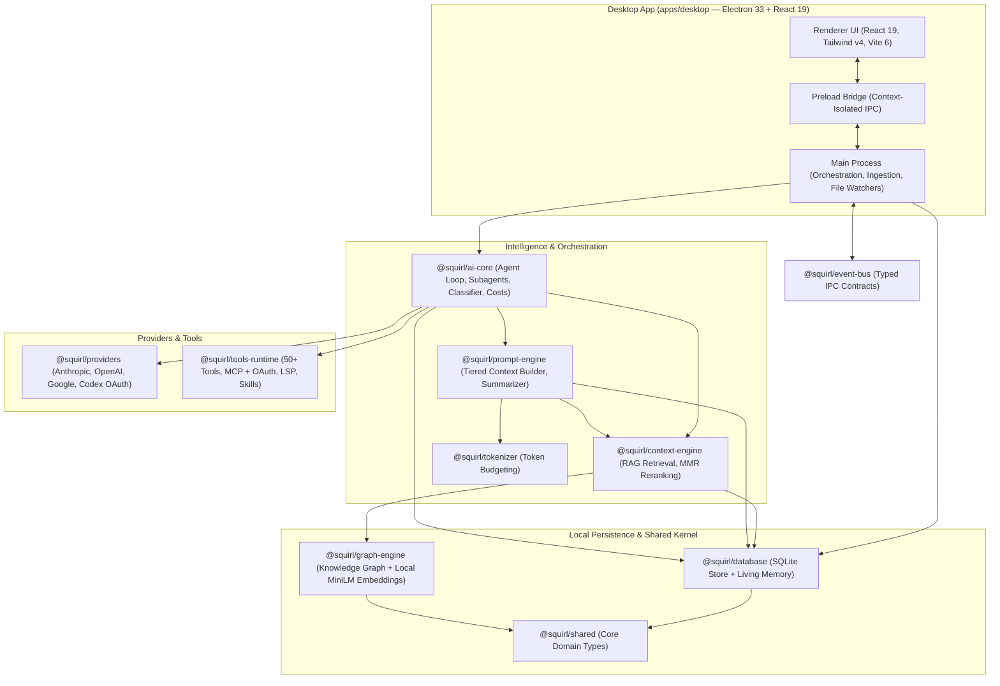

# Squirl 🐿️

[](https://github.com/SohamRupaye/ai-studio/actions/workflows/ci.yml)
[](https://github.com/SohamRupaye/ai-studio/actions/workflows/integration.yml)
[](https://github.com/SohamRupaye/ai-studio/actions/workflows/security.yml)
[](https://github.com/SohamRupaye/ai-studio/actions/workflows/release.yml)
[](LICENSE)
[](package.json)

> **A model-agnostic organizational intelligence layer — Git for AI-native work.**

Context is the primary object, not chat. Squirl accumulates knowledge, decisions, reasoning, and artifacts across branched workspaces so you never re-explain context to an AI again — and can switch models mid-conversation without losing state.

---

## Highlights

- **Branched Context Hierarchy (`Org → Project → Space → Chat → Branch`)** — Fork conversations like Git branches, share artifacts across forks, and track superseding memories per branch.
- **Local-First Context & Knowledge Graph** — SQLite-backed knowledge graph with local MiniLM-L6 embeddings (`@huggingface/transformers`), MMR reranking, progressive summarization, and tiered prompt budgeting — zero external vector DB required.
- **Model-Agnostic Provider Router** — Unified streaming interface across Anthropic, OpenAI, Google, OpenRouter, Codex OAuth (PKCE), and local Claude Code sessions with retry/fallback routing and cost tracking.
- **Extensible Agent & Tools Runtime** — Multi-agent delegation, 50+ built-in tools, Model Context Protocol (MCP) client over stdio/SSE/Streamable HTTP with OAuth PKCE, Language Server Protocol (LSP) integration, and a hot-reloading Skills system.
- **Production-Grade Engineering & CI/CD** — Strict TypeScript monorepo (Yarn 4 + Turborepo), automated unit/integration test suites, Electron Forge packaging verification, CodeQL (`security-extended`), Trivy SARIF scanning, and `jscpd` duplication gates.

---

## Status & Roadmap

Squirl is a **public v0.1 engineering showcase (active WIP)**:

- **Built & tested today** — Core monorepo backend (11 packages, 740+ unit & integration tests), local SQLite `Org → Project → Space → Chat → Branch` store, local MiniLM-L6 knowledge graph & MMR RAG retrieval, multi-provider router + Codex OAuth PKCE, 50+ tools, MCP OAuth 2.1 client, LSP client, Skills system, PDF/DOCX/XLSX ingestion, Electron + React 19 desktop app, and end-to-end DevSecOps + multi-OS Electron release pipelines.
- **In progress** — UI polish & onboarding walkthrough, additional renderer component/E2E tests, and async multi-user branch sync (push/pull/merge).

---

## Architecture



---

## Monorepo Layout

| Workspace | Responsibility |
| --- | --- |
| `apps/desktop` | Electron 33 desktop application (main process, preload bridge, React 19 renderer, document ingestion for PDF/DOCX/XLSX) |
| `packages/ai-core` | Agent loop, subagent orchestration, query classifier, cost tracker, artifact extraction, file snapshots |
| `packages/context-engine` | Hybrid RAG retrieval, MMR reranking, cross-branch knowledge sharing |
| `packages/prompt-engine` | Tiered context window assembly, progressive summarization, `@file` reference expansion |
| `packages/graph-engine` | SQLite-backed knowledge graph with local MiniLM-L6 embeddings via Transformers.js |
| `packages/database` | SQLite persistence (`better-sqlite3`) for org/project/space/chat/branch hierarchy + branch-aware living memory |
| `packages/providers` | Multi-provider streaming adapters, retry router, Codex OAuth PKCE, YAML config store |
| `packages/tools-runtime` | 50+ built-in tools, MCP multi-transport client + OAuth, LSP client, Skills installer/watcher |
| `packages/event-bus` | Typed IPC channel contracts (40+ channels) |
| `packages/tokenizer` | Model context limits and token estimation (`tiktoken`) |
| `packages/shared` | Shared domain types and utilities |
| `packages/ui` | Shared React IPC hooks |
| `tooling/*` | Shared ESLint 9, TypeScript 5.7, and Vitest 4 configs |

---

## CI/CD & Security Pipelines

Four purpose-built GitHub Actions workflows backed by a shared [setup-workspace](.github/actions/setup-workspace/action.yml) composite action:

| Workflow | Trigger | Checks |
| --- | --- | --- |
| [**CI**](.github/workflows/ci.yml) | PRs & pushes (`dev`, `main`) | Package build, TypeScript typecheck, ESLint, `jscpd` duplicate check, fast unit tests with V8 coverage artifacts, and Electron desktop bundle verification |
| [**Integration Tests**](.github/workflows/integration.yml) | Merges/pushes (`dev`, `main`) + manual | Rebuilds `better-sqlite3` for Node ABI and runs full integration suite (SQLite persistence/migrations, loopback MCP/OAuth/Skills servers, LSP stdio, PDF/DOCX/XLSX ingestion, and cross-package agent workflows) |
| [**Security**](.github/workflows/security.yml) | PRs, pushes (`dev`, `main`), weekly cron | **CodeQL (SAST)** (`security-extended`) + **Trivy (SCA & Secrets)** (`HIGH,CRITICAL`) with SARIF upload to GitHub Security |
| [**Release (CD)**](.github/workflows/release.yml) | Version tags (`v*.*.*`) + manual | Cross-platform matrix build (`macOS`, `Linux`, `Windows`) via Electron Forge (`.dmg`/`.zip`, `.deb`/`.rpm`, `.exe`), SHA-256 checksums, and automated draft GitHub Releases |

---

## Engineering Deep-Dive Docs

The [docs/deep-dive/](docs/deep-dive/README.md) folder documents the design, architecture, trade-offs, and debugging stories behind the codebase:

| Guide | Topic |
| --- | --- |
| [Deep-Dive Index](docs/deep-dive/README.md) | Guided tour and reading order |
| [01 — The Pitch](docs/deep-dive/01-the-pitch.md) | Problem, vision, and product thesis |
| [02 — Architecture Overview](docs/deep-dive/02-architecture-overview.md) | 10,000-foot system view and request flow |
| [03 — Data Model & Persistence](docs/deep-dive/03-data-model.md) | Branching/forking model (`database`, `shared`, `event-bus`) |
| [04 — Providers & Models](docs/deep-dive/04-providers-and-models.md) | Model-agnostic adapters, routing, and token limits |
| [05 — The Context Engine](docs/deep-dive/05-context-engine.md) | Knowledge graph, local embeddings, RAG, and living memory |
| [06 — Agent Loop & Subagents](docs/deep-dive/06-agent-loop-and-subagents.md) | Tool-call loop, guardrails, classifier, and delegation |
| [07 — Tools, MCP, LSP & Skills](docs/deep-dive/07-tools-mcp-lsp-skills.md) | Tool registry, MCP OAuth, LSP diagnostics, and skills |
| [08 — The Desktop App](docs/deep-dive/08-desktop-app.md) | Electron process model, IPC boundary, and end-to-end `chat:send` |
| [09 — Frontend & Design System](docs/deep-dive/09-design-system.md) | React 19 UI architecture and design tokens |
| [10 — Key Decisions & Trade-offs](docs/deep-dive/10-key-decisions.md) | Architectural decisions and rejected alternatives |
| [11 — Hard Problems Solved](docs/deep-dive/11-hard-problems-solved.md) | Real debugging write-ups, root causes, and regression tests |
| [12 — Anticipated Q&A](docs/deep-dive/12-anticipated-qa.md) | Technical Q&A across product, architecture, and operations |
| [13 — Demo Script](docs/deep-dive/13-demo-script.md) | Walkthrough and talking points |
| [14 — Quick Facts & Glossary](docs/deep-dive/14-quick-facts-and-glossary.md) | Reference sheet |

---

## Tech Stack

| Layer | Technology |
| --- | --- |
| Runtime | Electron 33, Node.js 20+ |
| Language | TypeScript 5.7 |
| Monorepo & Build | Yarn 4.1, Turborepo 2, Vite 6, Electron Forge |
| Frontend | React 19, Tailwind CSS v4, React Router 7 |
| Database | SQLite (`better-sqlite3`) |
| Local Embeddings | `@huggingface/transformers` (MiniLM-L6, offline) |
| Testing & Quality | Vitest 4, ESLint 9, `jscpd`, CodeQL, Trivy |

---

## Getting Started

**Prerequisites:** Node.js ≥ 20, Corepack enabled (`corepack enable` for Yarn 4)

```bash
make install   # install workspace dependencies (rebuilds native SQLite for Electron)
make build     # build all packages
make desktop   # launch the Electron desktop app in dev mode
```

### Common Commands

```bash
make help            # list all available Make targets
make dev             # run all packages in watch mode
make test            # run all tests (unit + integration)
make test-unit       # run fast unit tests only (no SQLite/sockets)
make test-integration # run integration tests only
make test-summary    # run tests uncached with an aggregated pass/fail summary
make lint            # lint all packages with ESLint
make typecheck       # type-check all packages with tsc
make desktop-build   # build desktop main + renderer bundles
make desktop-package # package desktop app via Electron Forge
make clean           # remove build outputs and caches
```

> **Note on running tests locally:** `postinstall` compiles `better-sqlite3` for Electron's ABI. Before running `make test` under Node.js, run `npm rebuild better-sqlite3` (and `yarn rebuild:electron` afterward to switch back for `make desktop`).

---

## License

Licensed under the [MIT License](LICENSE).
